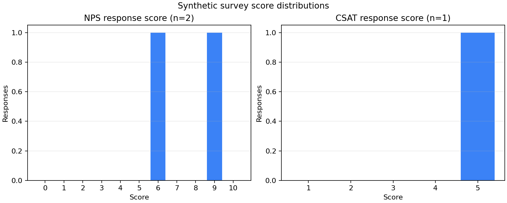
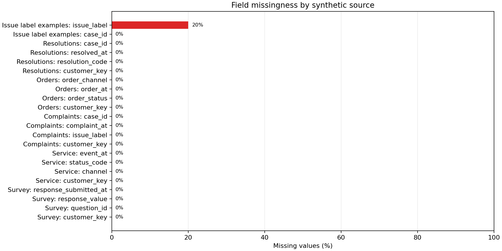
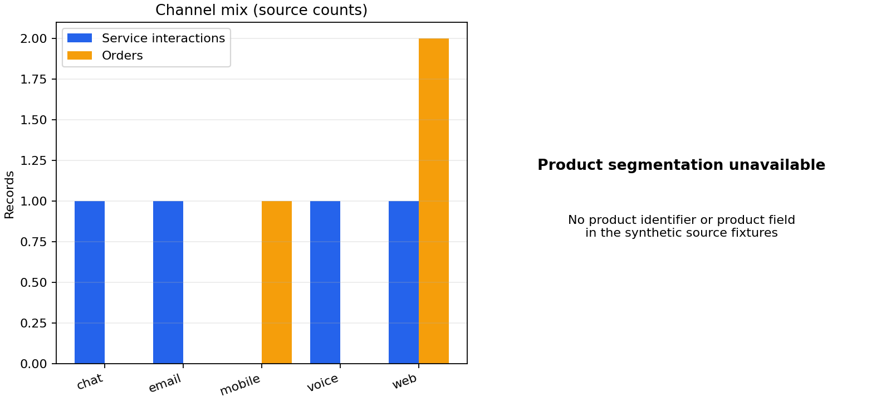
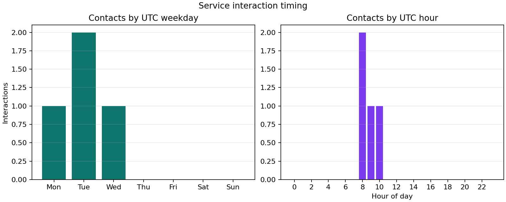
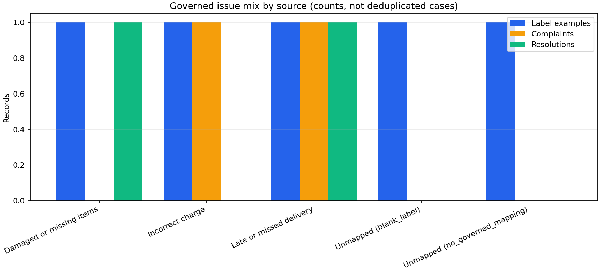
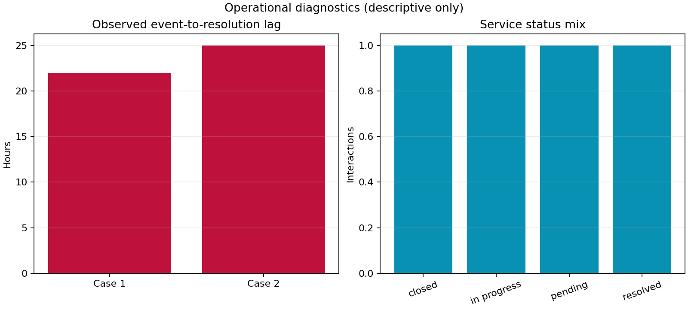

# CXSignal EDA and service diagnostics

**Generated:** 2026-11-16T06:38:22.993063Z  
**Scope:** checked-in synthetic fixtures only

## Findings

- Survey sample: 3 response rows. NPS sample has 2 scores and observed NPS 0.0; CSAT sample has 1 score(s). These values are descriptive only.
- Service sample: 4 interactions across 4 normalized channel labels; 3 orders across 2 order-channel labels.
- Issue taxonomy: 5 source issue-label examples, including 2 blank or unmapped labels. Complaint and resolution categories are shown separately because source rows may refer to the same case.
- Observed event-to-resolution lag proxy: 22.0h, 25.0h. This is not the official case resolution-time measure.
- Product-level segmentation is unavailable because the sample has no product field. Survey channel attribution is also unavailable.

## Charts

## Interpretation limits

- The fixtures are tiny, synthetic examples and are not representative of customers or operations.
- There is no product identifier or product segment in the sample, so product-segment analysis is unavailable.
- Survey records have no channel field and include an ambiguous customer/time linkage; score differences cannot be attributed to service interactions.
- The interaction fixture lacks case-created timestamps; plotted event-to-resolution lag is a proxy from the earliest observed interaction, not the official resolution-time KPI.
- Issue source counts overlap across examples, complaints, and resolutions and are not deduplicated case counts.
- All timestamps are converted to UTC for timing charts; actual operational analysis should use approved local/business calendars.
